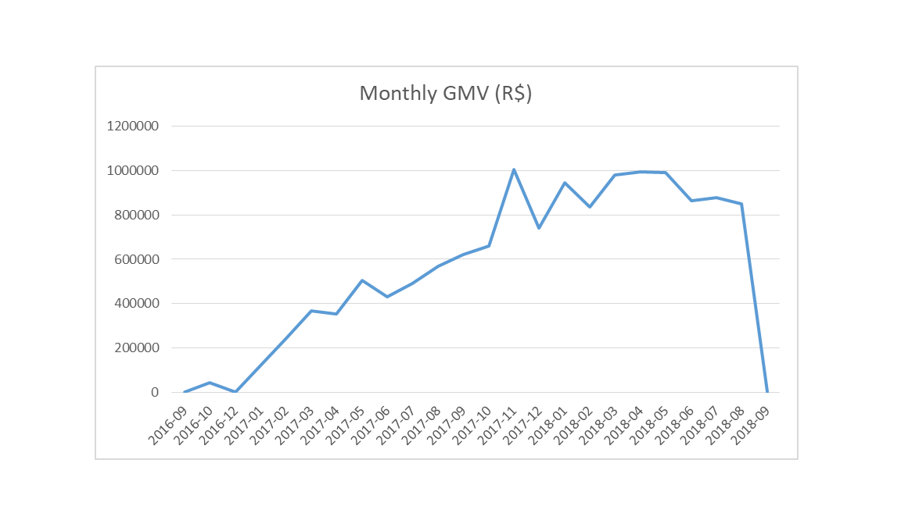
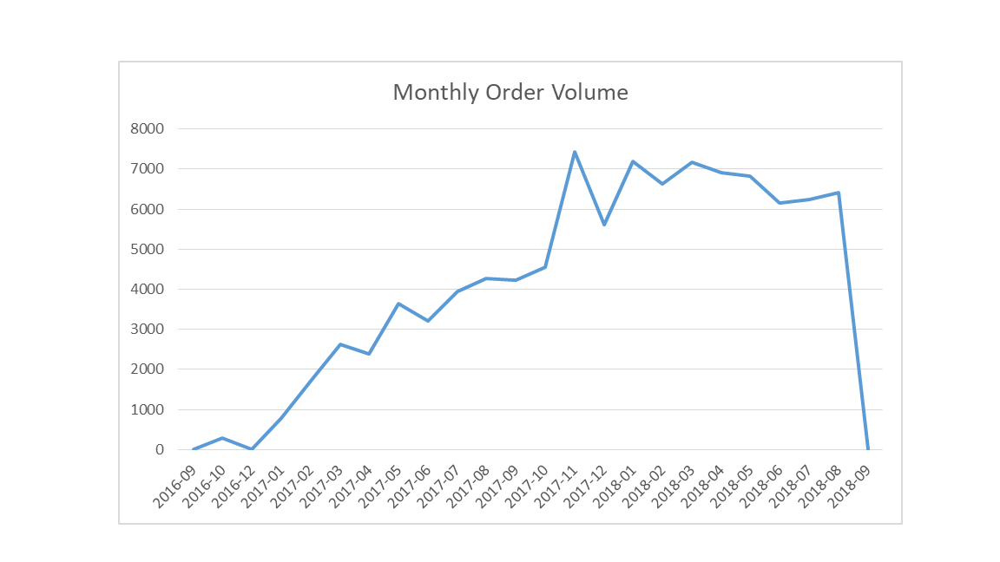
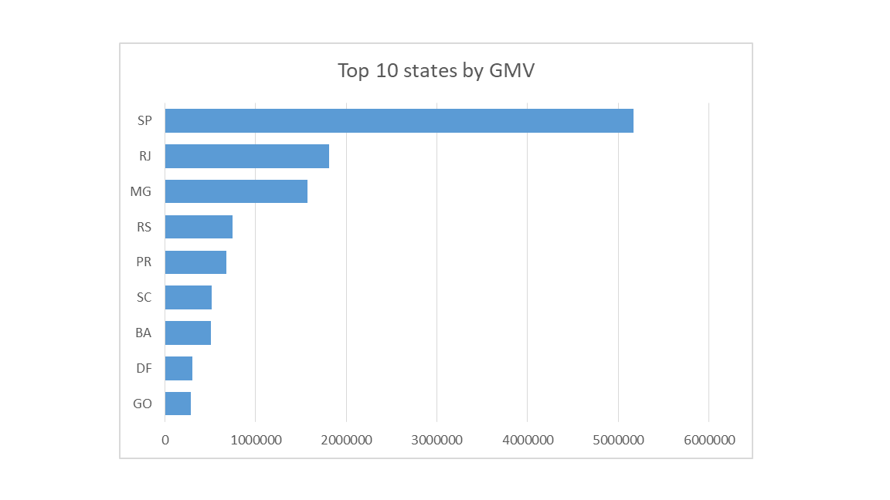
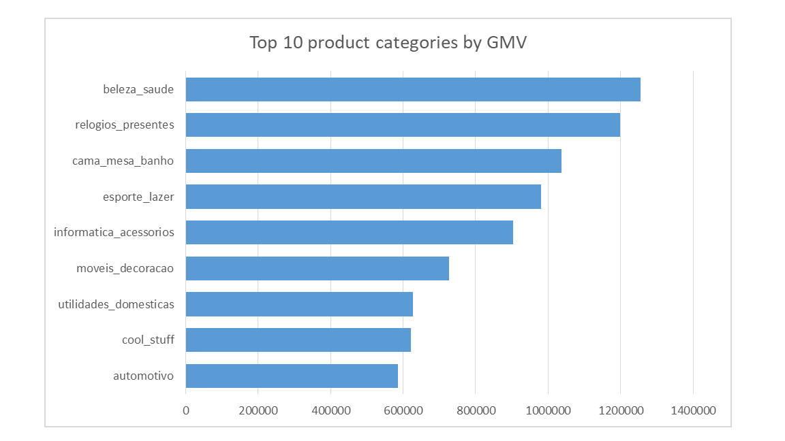
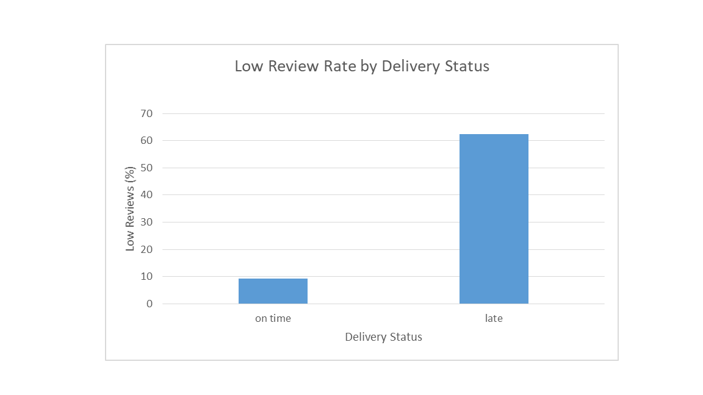

# Olist E-commerce Marketplace Analysis (SQL)

SQL analysis of Olist’s Brazilian e-commerce marketplace, exploring sales performance, customer purchasing behaviour, geographic trends, seller and category contributions, and the relationship between delivery delays and customer reviews using MySQL.

## Project Overview

Olist is a Brazilian e-commerce marketplace that connects customers with independent sellers. This project uses SQL to analyse marketplace performance, customer purchasing behaviour, geographic contribution, seller and product-category performance, and delivery-related customer satisfaction.

The objective was to understand how merchandise sales and order activity changed over time, how customers and sellers contributed to marketplace activity, and whether late deliveries were associated with lower customer review scores.

The analysis was conducted using MySQL and focuses on five business questions, with findings interpreted in a business context.

## Business Questions

1. **Marketplace Performance:** How do GMV, order volume, and average order value change over time?
2. **Customer Purchasing Behaviour:** How is the customer base changing, and what proportion of active customers have purchased before?
3. **Geographic Performance:** Which Brazilian states contribute the most customers and GMV, and how does GMV per customer vary?
4. **Seller and Product Category Performance:** Which sellers and product categories contribute most to GMV and order activity?
5. **Delivery and Customer Satisfaction:** How often are orders late, how does late delivery vary over time, and how is delivery performance associated with low review scores?

## Tools and Dataset

- **Database:** MySQL
- **SQL environment:** MySQL Workbench 8.0 CE
- **Dataset:** Olist Brazilian E-Commerce Public Dataset

The analysis uses the customer, order, order-item, product, seller, and review datasets.

The original dataset is available through the [Olist Brazilian E-Commerce Public Dataset on Kaggle](https://www.kaggle.com/datasets/olistbr/brazilian-ecommerce).

## SQL Techniques Used

- Joining related tables to combine marketplace data
- Aggregating business metrics using `SUM()`, `COUNT()`, and distinct counts
- Grouping data by month, state, seller, and product category
- Using common table expressions (CTEs) and temporary tables
- Applying window functions for seller rankings, GMV contribution, and cumulative contribution
- Using conditional logic to classify new and returning customers, delivery outcomes, and low review scores
- Checking imported datasets for missing and blank values

## Key Findings

### 1. Marketplace Performance

- GMV and order activity generally increased over the observed period, although activity fluctuated across months.
- Average order value varied, ranging approximately from **R$103 to R$152**.
- Three months had unusually low GMV-eligible order activity:
  - **September 2016:** 2 orders, generating R$207.86 in GMV.
  - **December 2016:** 1 order, generating R$10.90 in GMV.
  - **September 2018:** 1 order, generating R$145.00 in GMV.

These months were investigated rather than treated as evidence of a genuine collapse in marketplace demand. September 2016 covered only part of the month in the available timestamps, and December 2016 had activity recorded only on December 23. September 2018 covered a much longer timestamp span but had only one GMV-eligible order. The order data included 15 canceled orders with no order items and one shipped order with items.

These limitations make month-to-month comparisons less reliable at the edges of the dataset.

**Business implication:** Monthly trends should be interpreted alongside order volume and data coverage, rather than assuming every unusually low month reflects a change in customer demand.

### 2. Customer Purchasing Behaviour

- Returning customers accounted for a relatively small share of monthly active customers, reaching approximately **3% in some months**.
- September 2018 showed a 100% returning-customer share, but this was based on only one eligible customer and is not representative of normal activity.

The analysis identifies customers who had purchased in an earlier month. It measures the share of active customers who had purchased before, rather than formal cohort retention.

**Business implication:** Repeat purchasing appears limited in the observed monthly activity, making customer retention a potential area for further investigation.

### 3. Geographic Performance

- **São Paulo (SP)** had the highest customer count and GMV, followed by Rio de Janeiro (RJ) and Minas Gerais (MG).
- GMV per customer differed by state. For example, Bahia generated approximately **R$156 per customer**, compared with approximately **R$130 in São Paulo**.
- States with more customers generally generated more GMV, although the ranking by GMV per customer was different.

**Business implication:** High total GMV can reflect a larger customer base, while GMV per customer offers a complementary view of marketplace activity. It does not, however, measure profitability.

### 4. Seller and Product Category Performance

- The top 10 sellers accounted for approximately **13.2% of total GMV**.
- The leading seller generated approximately **R$229,238 in GMV**, representing around **1.7% of total GMV**.
- The highest-GMV categories included:
  - Health & Beauty: approximately **R$1.26 million**
  - Watches & Gifts: approximately **R$1.20 million**
  - Bed, Bath & Table: approximately **R$1.04 million**
- Bed, Bath & Table had the highest order count among these leading categories.

Category order counts can overlap because a single order may contain products from multiple categories.

**Business implication:** GMV contribution is spread across sellers, while category rankings vary depending on whether performance is measured by merchandise value or order activity.

### 5. Delivery Performance and Customer Satisfaction

Using delivered orders with both actual and estimated delivery dates, the order-level analysis found:

- **On-time deliveries:** 89,936 (93.23%)
- **Late deliveries:** 6,534 (6.77%)
- **Total eligible delivered orders:** 96,470

The monthly delivery analysis showed that March 2018 had the highest late-delivery rate among the months with substantial order volumes, at approximately **18.96%** (1,328 late deliveries out of 7,003 eligible orders).

Other months checked included November 2017 (12.40%), February 2018 (14.13%), and June 2018 (1.16%). September 2016 showed a 100% late-delivery rate, but this was based on only one eligible order and should not be interpreted as a meaningful performance trend.

For customer satisfaction, low review scores (1 or 2) were compared by delivery status at the **review-record level**:

- On-time deliveries: **9.28%** low reviews
- Late deliveries: **62.41%** low reviews

Low review scores were substantially more common among reviews associated with late deliveries. This indicates an association, not proof that delivery delays alone caused lower scores. Review counts are not equivalent to unique-order counts because the review data can contain multiple records for an order.

**Business implication:** Delivery reliability is an important area to monitor because late deliveries are strongly associated with poorer review outcomes in this dataset.

## Visual Findings

The following charts summarise selected results from the SQL analysis.

### 1. Monthly GMV



The chart shows monthly merchandise sales over the observed period. September 2018 appears as a sharp drop because only one eligible order was recorded, generating **R$145.00 in GMV**. This unusually low activity should not be interpreted as a typical monthly performance level or a confirmed collapse in marketplace demand.

### 2. Monthly Order Volume



Order volume fluctuated across the observed period. September 2018 shows an unusually low level of eligible order activity, with only one order included in the analysis. This explains the sharp decline at the end of the chart.

### 3. Top 10 States by GMV



São Paulo led in GMV, followed by Rio de Janeiro and Minas Gerais. The results show how marketplace activity is distributed geographically, with states having larger customer bases generally generating higher total GMV.

### 4. Top 10 Product Categories by GMV



Health & Beauty, Watches & Gifts, and Bed, Bath & Table were the leading categories by GMV. Category rankings can differ depending on whether performance is measured by merchandise value or order volume.

### 5. Low Review Rate by Delivery Status



Low review scores (1–2) represented 9.28% of reviews associated with on-time deliveries, compared with 62.41% for late deliveries. This substantial difference highlights the relationship between delivery performance and customer satisfaction, although it does not establish causation.

## Methodology and Limitations

- **GMV definition:** GMV is calculated as `SUM(price)` from order items. Freight charges are excluded, so this represents merchandise value rather than total customer payments or Olist revenue.
- **Order exclusions:** Canceled and unavailable orders are excluded from the main marketplace analyses.
- **Customer identification:** `customer_unique_id` is used to identify customers across orders.
- **Low-activity months:** Unusually low months were investigated and documented rather than interpreted as normal marketplace performance.
- **Delivery analysis:** The overall delivery calculation includes delivered orders with both actual and estimated delivery dates. Delivery status is based on calendar dates, so delivery on the estimated date counts as on time.
- **Review analysis:** The delivery-versus-review comparison is performed at review-record level, not unique-order level.
- **Missing categories:** Products without category names may affect category-level comparisons.
- **Interpretation:** The analysis is descriptive. It identifies patterns and associations but does not establish causality or measure seller profitability.

## Repository Structure

```text
olist-ecommerce-analysis/
├── README.md
├── sql/
│   ├── 01_data_import.sql
│   ├── 02_data_quality_checks.sql
│   ├── 03_marketplace_and_customers.sql
│   ├── 04_geography_sellers_categories.sql
│   └── 05_delivery_and_satisfaction.sql
├── results/
│   ├── q1_marketplace_performance.csv
│   ├── q2_customer_purchasing.csv
│   ├── q3_geographic_performance.csv
│   ├── q4_seller_performance.csv
│   ├── q4_category_performance.csv
│   ├── q5_overall_delivery.csv
│   ├── q5_monthly_late_delivery.csv
│   └── q5_delivery_and_reviews.csv
└── visuals/
    ├── delivery_and_customer_satisfaction.png
    ├── monthly_gmv.png
    ├── monthly_order_volume.png
    ├── top10_product_categories_gmv.png
    └── top10_states_gmv.png
```

The SQL files contain the import scripts, data-quality checks, and queries used to answer the five business questions. The eight CSV result files provide the underlying query outputs, while the charts highlight selected findings.

The raw CSV files are not included in the repository; users can obtain them from the original dataset source linked above.

## Conclusion

This project demonstrates how SQL can be used to turn related e-commerce datasets into business-focused analysis. The findings highlight fluctuations in marketplace activity, limited repeat purchasing, geographic differences in customer contribution, seller and category concentration, and a strong association between late delivery and low review scores.

The project combines practical SQL techniques with attention to data quality, appropriate metric definitions, and the limitations that should be considered when interpreting results.
